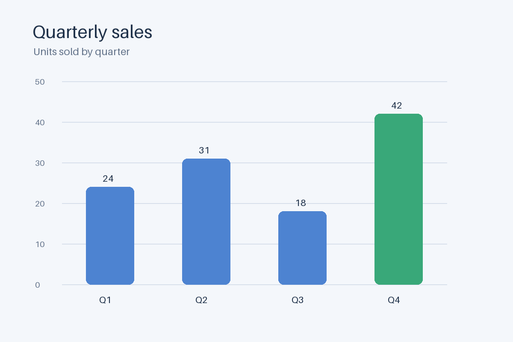
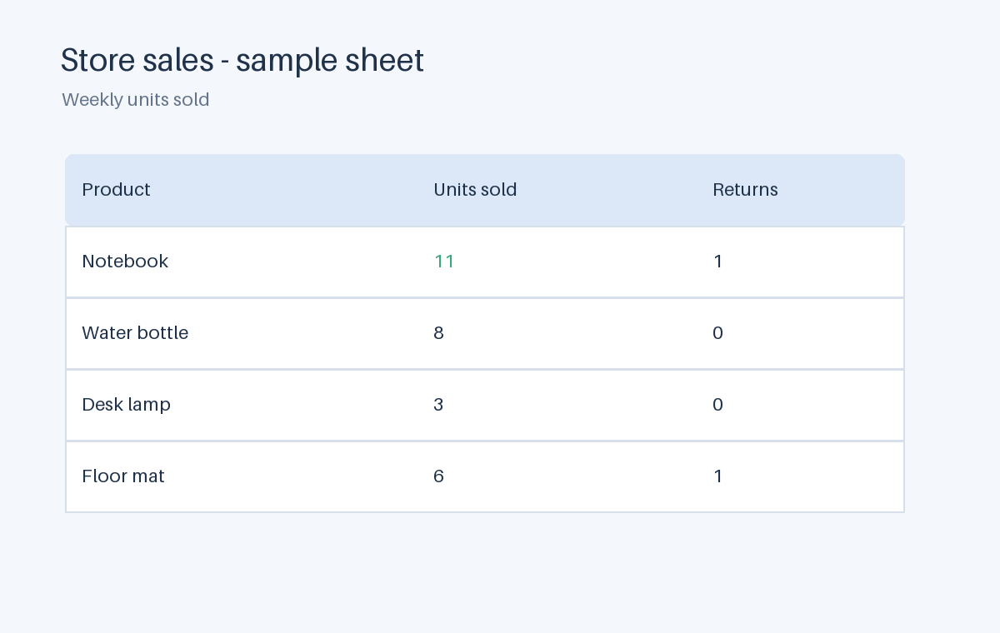

# decisionhello

A small command-line playground for trying [HAL-X-AI/THX-02](https://huggingface.co/HAL-X-AI/THX-02) locally, a model that answers typed decision questions about text and images. The demos include support-ticket triage, a chart, a spreadsheet, and object classification.

## Get started

You need Python 3.12. Installing the local runtime requires an internet connection and downloads PyTorch and other model dependencies. The first demo or classification run downloads about 9 GB of model files from Hugging Face; after that, inference runs locally from the cache without calling the HAL-X API or requiring internet access.

```bash
git clone https://github.com/TimelessP/decisionhello.git
cd decisionhello
python3.12 -m venv .venv
source .venv/bin/activate
python -m pip install -r requirements.txt
```

In PowerShell, activate the environment with:

```powershell
.\.venv\Scripts\Activate.ps1
```

Run a text demo. On the first run, the model downloads to the Hugging Face cache; later runs use the cached files:

```bash
python -m decisionhello demo --scenario support
```

By default, the app uses CUDA when available and otherwise runs on CPU. Select a device explicitly if needed:

```bash
python -m decisionhello demo --scenario support --device cpu
python -m decisionhello demo --scenario support --device cuda
```

The CPU option avoids requiring a CUDA GPU, but inference can be slower. The model weights require roughly 9 GB of disk space, in addition to the Python runtime and its dependencies.

The requirements include Flash Linear Attention 0.6.0 for accelerated CUDA inference. This pins a newer version than THX-02's fast extra, whose 0.5.2 release fails to import with the current Torch/Triton stack. Triton may compile kernels on the first CUDA inference, so that first call can take longer than subsequent calls.

For the optimized CUDA convolution kernel, install [`requirements-cuda.txt`](requirements-cuda.txt) after setting `CUDA_HOME` and `PATH` to a CUDA toolkit compatible with your installed PyTorch. The package builds a native extension, so install it without build isolation after the base requirements (including PyTorch) are installed:

```bash
CUDA_HOME=/path/to/cuda PATH=/path/to/cuda/bin:$PATH \
  python -m pip install --no-build-isolation -r requirements-cuda.txt
```

This optional extension is CUDA-only; CPU inference does not use it.

The response contains the selected answer and probabilities. For example, support triage returns a suggested team, urgency, and whether the customer asks for a refund. Answers are model predictions, not guaranteed facts.

## Try the image demos

Each command uses the local model and a checked-in example image:

```bash
python -m decisionhello demo --scenario chart
python -m decisionhello demo --scenario spreadsheet
python -m decisionhello demo --scenario dog
python -m decisionhello demo --scenario bicycle
python -m decisionhello demo --scenario mug
```

The chart asks which quarter has the most units sold; the spreadsheet asks which product has the highest sales count. The other images ask the model to identify the pictured object.

| Chart | Spreadsheet |
|---|---|
|  |  |

Object examples: [dog](examples/images/dog.png), [bicycle](examples/images/bicycle.png), [mug](examples/images/mug.png).

To run every included demo in sequence:

```bash
python -m decisionhello demo --scenario all
```

The local runtime does not include THX-02's optional thinking service.

## Classify your own image

Pass a local image path and a comma-separated set of candidate labels:

```bash
python -m decisionhello classify path/to/photo.png
python -m decisionhello classify path/to/photo.png --labels "dog,cat,wolf,other"
python -m decisionhello classify path/to/photo.png --question "Which vehicle is shown?"
```

The default labels are `dog,bicycle,mug,chart,spreadsheet,other`. The image is processed locally and is not sent to the HAL-X API.

## Regenerate example images

Five synthetic sample images are checked in under `examples/images/`. They are generated locally with Pillow and do not require a separate image-generation service:

```bash
python scripts/create_examples.py
```

## Other useful commands

```bash
python -m decisionhello --help
python -m decisionhello demo --help
python -m unittest discover -s tests -v
```

## How it works

`thx02[local]` is the official Python package with its local model runtime. The app supplies a state, one or more typed questions, and optionally an image path; the model returns answers and probability distributions. Model files are cached by Hugging Face. The example image generator uses Pillow.

The THX-02 model is provided by HAL-X and is separate from this MIT-licensed example application. See the [model card](https://huggingface.co/HAL-X-AI/THX-02) for model terms, runtime details, and limitations. This toy app is for experimentation, not consequential decisions.
